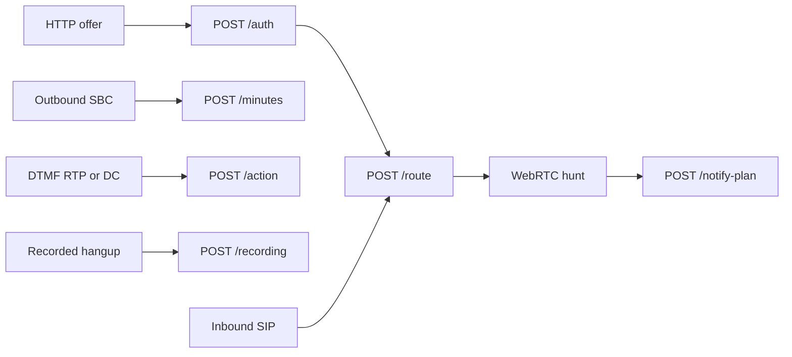

# Siphon → business wrapper API

Every HTTP call siphon makes to the secnum / lightpbx logic wrappers.
Implemented in `logic_client.py` (`_post_logic`, `authenticate_offer`,
`resolve_destination`, `fetch_notify_plan`, `decide_action`, `post_recording_wav`,
`check_outgoing_minutes`).

Wrappers also expose `GET /health` / `GET /healthz`. Siphon does not call those.
Siphon does call `POST /minutes` on the caller `logicSp` before an outbound SBC INVITE.

## Transport

- **Base URL:** `config.json` `common.clientIngress.secnumLogic.baseUrl` /
`logicProviders[].baseUrl`. If that list is absent, `{PROVIDER_ID}_LOGIC_URL`
(or `{PROVIDER_ID}_LOGIC_BASE_URL`) overrides the legacy per-provider block.
- **Timeout:** `timeoutMs` on that entry (currently 15000).
- **Most calls:** `POST {baseUrl}{path}` with `Content-Type: application/json`.
- `/recording`**:** raw `audio/wav` body + headers; `Authorization: Bearer <GCP SA id_token>` (audience = wrapper `baseUrl`).
- Siphon stamps `_httpStatus` and `_logicSp` on the parsed response locally.
They are not sent by the wrapper. HTTP ≥400 without `ok` / `route` / `action`
is treated as `ok: false`.
- **Required vs optional** below is wrapper-enforced (`4xx` / throw) vs siphon
gating (fail closed / branch). Siphon often *sends* fields the wrapper never
reads. `ok: true` is **not** required: siphon only fails when HTTP ≥400 or
`ok === false`. A 200 with no `ok` is success.

**Pin vs fan-out:** notify listen port pins SP (`:9001` secnum, `:9002` lightpbx).
After `/auth` ok, `from` is remembered as caller `logicSp`. `/route` always
fans out **dest `to`** across every configured wrapper: first claimed
`webrtc` / `webrtc-multiring` / product wins; unclaimed `sbc` is last resort.
`/notify-plan` pins to dest `route.logicSp`, then fans out on miss.
`/action` and `/recording` stay on caller `logicSp`.

---

## `POST /minutes`

**When:** Outbound SBC INVITE only (`start` before `send_request`, `sync` after the SBC answers and again at least every 30s, `end` on teardown). Inbound, internal WebRTC, and OpenAI/IVR are not posted.

**Pin:** Caller `logicSp` from the notify listen port (`callerLogicSp`). A missing route, timeout, or HTTP 404/5xx is fail-open: the call continues. Siphon hangs up only when `allowed` is false or `remainingMs` is `0`.

### Params (JSON)

| Field | Type | Meaning |
| --- | --- | --- |
| `event` | string | `start`, `sync`, or `end`. |
| `from` | string | Caller identity. Light PBX resolves the group. Secnum uses the caller digits. |
| `to` | string | Dialed number. |
| `sessionId` | string | Siphon session. |
| `durationMs` | int? | Answered talk time. Sent on `end`. The wrapper bills from its own `inFlight` clock when that row exists. |

### Returns

| Field | Type | Meaning |
| --- | --- | --- |
| `allowed` | bool | `false` stops the call. |
| `remainingMs` | number? | Omitted when this caller has no ceiling. `0` stops the call. |

Light PBX reads `lightpbxCatalog/outgoingMinutes` (`il`/`nl` → `basic`/`standard`/`super` minutes) and writes `lightpbxOutgoingUsage/{systemId}`. Secnum reads `secnumCatalog/outgoingMinutes.numbers[digits]` and writes `secnumOutgoingUsage/{digits}`. A missing catalog entry is no ceiling. Usage `period` is `YYYY-MM` in `Asia/Jerusalem` and rolls on the next event.

## `POST /auth`

**When:** Client HTTP `/notify` offer only. `origin=sbc` is skipped in siphon
(no POST). Ice-batch / cancel / reject do not re-auth when the session exists.

**Pin:** Known listen port → that wrapper only. Unknown port → try each
configured provider; first `ok` wins.

### Params (JSON)

| Field       | Type   | Meaning                                  |
| ----------- | ------ | ---------------------------------------- |
| `origin`    | string | Usually `client`. `sbc` is never posted. |
| `from`      | string | Caller identity (DID or `sys…` seat).    |
| `to`        | string | Dialed dest.                             |
| `sdp`       | string | Offer SDP (unused for verify).           |
| `sessionId` | string | Pair key `from|to`.                      |
| `xsign`     | string | ECDSA of `xdata`.                        |
| `xdata`     | string | Signed payload (`uuid:timestamp`).       |
| `type`      | string | `offer` (and similar).                   |

### Returns

| Field                           | Type          | Meaning                                                 |
| ------------------------------- | ------------- | ------------------------------------------------------- |
| `ok`                            | true          | Anything else / HTTP ≥400 → `IdentityError`, call dies. |
| `mode`                          | string        | `ans-ens` or `lightpbx-seat`.                           |
| `signer`                        | address       | Recovered wallet.                                       |
| `wallet`                        | address       | ENS/config owner; must match `signer`.                  |
| `web3identity`                  | string        | On-chain name.                                          |
| `web2identity`                  | string | null | ANS mapped DID; null for seats.                         |
| `productItemId`                 | string?       | Seat id when `from` is `sys…`.                          |
| `sessionId` / `to` / `identity` | echo          | Pass-through.                                           |

**Summary:** Gate the caller. Siphon does not recover the signer itself — the
wrapper checks `x-sign` against ANS (DID) or lightpbx-config seat `web3identity`.
Fail closed. On ok, siphon pins `logicSp` on `from` so later `/route` and
`/action` hit the same wrapper.

**lightpbx:** Seat `from` (`sys…`) → directory `me.web3identity` owner. DID
`from` → ANS mapping + polygon ENS owner.

**secnum:** ANS mapping + ENS owner. No seat path.

---

## `POST /route`

**When:** After auth on outbound `/notify`. Also inbound SIP (`origin=sbc`, no
`/auth`).

**Pin:** Always fan-out dest `to` to every wrapper URL. First claimed webrtc /
multiring / product wins and is cached as that owner. If nobody claims, the
`sbc` body from the authenticator of `from` (`logicSp`) is the trunk and that
product is what gets cached. With no authenticator, the unclaimed pair is
still stored as `secnum`. Siphon copies `callerId` from the caller wrapper
when the dest winner omitted it. Cover number is wrapper-owned
(`outboundCallerId`); siphon does not invent CLI.

### Params (JSON)

| Field                     | Type          | Meaning                                                                           |
| ------------------------- | ------------- | --------------------------------------------------------------------------------- |
| `kind`                    | string        | `outbound` | `inbound`. Wrappers also accept `callerid`; siphon does not send it. |
| `origin`                  | string        | `client` | `sbc` | `partner`.                                                     |
| `from` / `to`             | string        | Identities. Siphon strips `+` and domain suffix first.                            |
| `sessionId`               | string | null | Optional.                                                                         |
| `parsedTo` / `parsedFrom` | object        | `{ type, value, full, domain? }` from `parse_address`.                            |

### Returns (fields siphon branches on)

| Field                                                  | Type           | Meaning                                                                                        |
| ------------------------------------------------------ | -------------- | ---------------------------------------------------------------------------------------------- |
| `route`                                                | enum           | `webrtc` | `webrtc-multiring` | `sbc` | `external-sip` (IVR/OpenAI) | `openai-sip` | `reject`. |
| `routingSource`                                        | string?        | `lightpbx` when that wrapper owns the DID. Empty `sbc` is **not** a claim.                     |
| `notifyIdentity` / `ensName` / `wallet`                | string?        | WebRTC dest.                                                                                   |
| `targets[]`                                            | array?         | Hunt seats: `notifyIdentity`, `isExtension`, `productItemId`.                                  |
| `isExtension` / `productItemId`                        | bool / string? | Hunt occupancy.                                                                                |
| `sipUri`                                               | string?        | Product hairpin (`sip:proj_…@sip.api.openai.com`).                                             |
| `number` / `host` / `sbcAddress`                       | string?        | PSTN trunk.                                                                                    |
| `callerId`                                             | string?        | lightpbx outbound CLI (seat DID) on **all** outbound routes, not only `sbc`. |
| `callRecordingEnabled` / `systemId` / `recordingEmail` | ?              | Recording extras (lightpbx).                                                                   |
| `ringTimeoutSeconds`                                   | number?        | Default 25.                                                                                    |
| `reason` / `statusCode`                                | ?              | `reject`.                                                                                      |

Siphon `normalize_route_decision` maps those into:

| `route`                           | Siphon behavior                          |
| --------------------------------- | ---------------------------------------- |
| `webrtc`                          | Single-seat hunt + DC RING               |
| `webrtc-multiring`                | Ring all `targets`; first DC pickup wins |
| `external-sip` / `openai` / `ivr` | Hairpin PC2 → `sipUri`                   |
| `sbc`                             | Hairpin → Cellact SBC `host:5061`        |
| `reject`                          | Fail the offer / INVITE                  |

**Summary:** Who owns this dest and how to terminate. Siphon is SP-blind except
these fields.

**lightpbx:** DID lookup → IVR (`external-sip` + `sipUri`), seats
(`webrtc` / `webrtc-multiring`), or `sbc`. Internal `sys…` → webrtc. Partner
origin can return `claimed: false`.

**secnum:** ANS hit → `webrtc`. Miss on outbound → `sbc`. Inbound miss → `reject`.

---

## `POST /action`

**When:** DTMF — RFC4733 (media-worker / rtpengine) or DC digit. Runs for
product/IVR legs **and** secnum→sbc. Retransmits deduped ~400ms.

**Pin:** Always session `logicSp`. No fan-out. Missing `logicSp` → local
`action: none` (no POST).

### Params (JSON)

| Field            | Type    | Meaning                                             |
| ---------------- | ------- | --------------------------------------------------- |
| `origin`         | string  | Session `routeKind` (`client` / `sbc` / …).         |
| `from` / `to`    | string  | Session parties. IVR `to` stays the DID.            |
| `sessionId`      | string  | Siphon session id.                                  |
| `digit`          | string  | `0-9` (and `*#ABCD` if present).                    |
| `action`         | string  | `dtmf` or DC action name.                           |
| `dtmfIndex`      | int     | 0-based hop for this press.                         |
| `dtmfCount`      | int     | Presses so far including this one.                  |
| `route` / `type` | string? | Current session route.                              |
| `message`        | object  | Raw DC / rtpengine payload (`source` `rtp` | `dc`). |

### Returns

| Field                                               | Type    | Meaning                                                                                                        |
| --------------------------------------------------- | ------- | -------------------------------------------------------------------------------------------------------------- |
| `action`                                            | enum    | `transfer` | `redirect` | `forward` | `none` | `reject`. A webrtc `route` in the body is forced to `transfer`. |
| `digit` / `dtmfIndex` / `dtmfCount`                 | echo    | Appended to session `dtmfLog`.                                                                                 |
| `reason`                                            | string? | `unmapped_digit` | `dtmf_passthrough` | `not_ivr` | `secnum_sbc_passthrough` | …                               |
| `route` / `notifyIdentity` / `target` / `targets[]` | ?       | Transfer dest (hunt).                                                                                          |
| `isExtension` / `productItemId`                     | ?       | Seat transfer.                                                                                                 |
| `callRecordingEnabled` / `systemId` / `number`      | ?       | Same recording extras as `/route`. Copy onto the session; do not invent.                                       |

Siphon `apply_action_decision`:

| `action`                 | Siphon behavior                                                          |
| ------------------------ | ------------------------------------------------------------------------ |
| `transfer` / `redirect`  | Drop OpenAI, hunt `notifyIdentity` / `targets`                           |
| `forward`                | DC: rtpengine `inject DTMF`. RTP: TE already in media (no second inject) |
| `none` / missing logicSp | No-op                                                                    |
| `reject`                 | `fail_notify_call` — hang up                                             |

**Summary:** In-call policy. Each result is stored on `dtmfLog` and later sent
on `/recording` as `x-dtmf-log`.

**lightpbx:** IVR only. Hop 0 matches `ivr.menu` digit → `transfer`. Hop ≥ 1
with today’s JSON (no `ivr.hops[]`) → `forward` / `dtmf_passthrough`. Later:
`ivr.hops[i].menu`. Non-IVR → `forward` / `not_ivr`.

**secnum:** Always `forward` with `reason: secnum_sbc_passthrough`. No IVR JSON.

---

## `POST /notify-plan`

**When:** Outbound WebRTC hunt, before APNs/FCM/on-chain notify. Fail closed —
siphon has no chain fallback.

**Pin:** Dest `route.logicSp` first. 4xx / empty `steps` → fan-out until a
wrapper returns a non-empty `steps[]`. Never use caller `session.logicSp`.

### Params (JSON)

| Field              | Type    | Meaning                                      |
| ------------------ | ------- | -------------------------------------------- |
| `from`             | string  | Caller.                                      |
| `to`               | string  | Seat/DID being rung (may already be `sys…`). |
| `message`          | string  | Signaling JSON (offer SDP, candidates, …).   |
| `notificationType` | int     | `0` = CALL, `4` = REALTIME_SIGNAL.           |
| `targetWallet`     | string? | Optional hint.                               |
| `sessionId`        | string? | Optional.                                    |

### Returns

| Field                           | Type     | Meaning                                                                                                           |
| ------------------------------- | -------- | ----------------------------------------------------------------------------------------------------------------- |
| `ok`                            | true     | HTTP ≥400 or `ok: false` aborts notify.                                                                           |
| `steps[]`                       | required | Each: `url`, `method`, `contentType`, `body`, `headers`, `fallbackUrl`, `responseExtractField`, `placeholderKey`. |
| `to` / `notifyIdentity`         | string?  | lightpbx may rewrite to `sys…` for the plan.                                                                      |
| `targetWallet` / `web3identity` | string?  | Wallet used for signing placeholders.                                                                             |

Empty `steps` → hard fail. Siphon executes steps in order (HTTP, `eth_call`, APNs).

**Summary:** Wrapper owns how to wake the phone.

**lightpbx:** Resolves DID/seat → `sys` id, patches `message.to`,
`LightPBXNoti.getSignalingPlan`.

**secnum:** `to` must be a mapped WebRTC user or 404.
`ApplicationNotifier.getApplicationTokenPlan`.

---

## `POST /recording`

**When:** Soft-end / teardown when `callRecordingEnabled` and a wav exists.
Not JSON — raw wav.

**Pin:** Session `logicSp`. Auth is the kamailio-gcp-mapping service-account
Google ID token, not `x-sign`.

### Params (headers + body)

| Field                                           | Where  | Meaning                                                 |
| ----------------------------------------------- | ------ | ------------------------------------------------------- |
| `Authorization`                                 | header | `Bearer <GCP id_token>`.                                |
| `Content-Type`                                  | header | `audio/wav`. Body = wav bytes.                          |
| `x-call-id`                                     | header | `mediaCallId` / sessionId.                              |
| `x-did` / `x-number`                            | header | Recorded DID.                                           |
| `x-system-id`                                   | header | lightpbx `systemId`.                                    |
| `x-winner`                                      | header | Hunt winner or session `to`.                            |
| `x-from`                                        | header | Caller.                                                 |
| `x-session-id`                                  | header | Siphon session.                                         |
| `x-started-at` / `x-ended-at` / `x-duration-ms` | header | Unix seconds + duration.                                |
| `x-dtmf-log`                                    | header | JSON `[{digit, dtmfIndex, action, reason, target}, …]`. |

### Returns

| Field                      | Type  | Meaning                                                |
| -------------------------- | ----- | ------------------------------------------------------ |
| `ok` / `emailed` / `saved` | bool  | `saved` is always false — email only, then wipe bytes. |
| `to`                       | email | `recordingEmail` from DID config.                      |
| `did` / `callId` / `bytes` | meta  | Echo.                                                  |

**Summary:** Email the wav (and DTMF / transfer lines) then discard.

**lightpbx:** SMTP to `recordingEmail`. Body includes `DTMF:` lines from
`x-dtmf-log` and `Transfers:` from `x-transfer-log`. IVR DIDs are allowed
when `callRecordingEnabled` is set on the number (same as hunt).

**secnum:** No `/recording`. Siphon will 404 if `logicSp=secnum` and recording
is enabled.